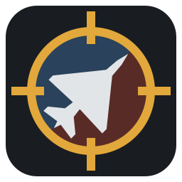
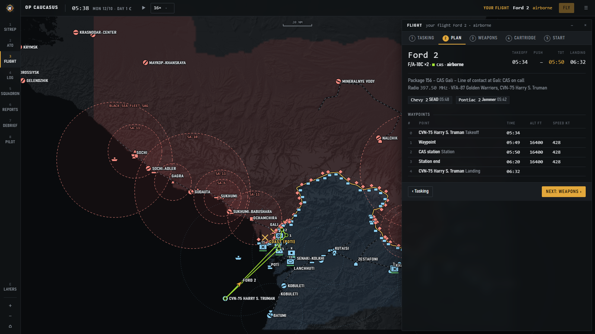

<p align="center"></p>

<h1 align="center">Warclock</h1>
<p align="center"><b>A real-time dynamic campaign for DCS World – in the spirit of Falcon BMS.</b><br>
The war keeps running whether you fly or not. You pick a flight from the ATO, Warclock builds the mission, DCS flies it, the results flow back.</p>

<p align="center"></p>

## What it does

- **A living war.** A campaign clock (1× … 1024×) drives both sides: air tasking orders, ground offensives along several axes, convoys, trains, freighters, depots and a war economy that can be bombed out.
- **Both sides plan.** CAP, sweep, escort, SEAD/DEAD, jammers, OCA, strike, CAS, BAI, interdiction, anti-ship, recon, CSAR, transport, AWACS and tankers, plus Iranian missile and drone salvos. Packages are assembled automatically, or you build your own.
- **Fly any flight with a cockpit.** A five-step planner (tasking → route plan → weapons → cartridge → start) like BMS. Join flights that are already airborne with an air start.
- **Missions generated for you.** Warclock writes the `.miz` to `Saved Games\DCS\Missions\Kampagne`, tracks the sortie through `dcs.log` and feeds kills, losses and damage back into the campaign.
- **Fog of war.** Radars, recon and intel decide what you see. Pre-war intel, decoys and stale contacts included.
- **Theaters.** Caucasus (Russia attacks Georgia, NATO supports from the air) and the Persian Gulf (amphibious landing in the Northern Emirates, Iran outside Dubai, Tanker War).
- **Your order of battle.** Choose which aircraft each nation flies when you start a campaign, including F-14A / F-14B / F-14B(U), carriers (Supercarrier or Stennis) and the start time of the war.
- **Multiplayer.** Other players plan their own flights in their browser over the network; the optional server hook locks slots and loads the next mission by itself.
- **Optional extras.** [Splash Damage script](https://www.digitalcombatsimulator.com/en/files/3344761/) (Stevey666) for realistic blast effects, and [DCS-ATC](https://github.com/Iceman1991/DCS-ATC-Release) for voice ATC, AWACS and JTAC/FAC(A) on CAS missions.

## Requirements

- Windows 10/11 (64-bit)
- DCS World with the Caucasus and/or Persian Gulf map
- A browser (the interface opens at `http://localhost:8642/`)

No admin rights needed. Warclock does not modify your DCS installation; the optional live hook goes into `Saved Games\DCS\Scripts\Hooks`.

## Install

1. Download `Warclock-Setup.exe` from the latest release.
2. Run it. Windows SmartScreen may warn because the installer is not code-signed: *More info → Run anyway*. Compare the SHA256 from the release notes if you want to be sure:
   ```powershell
   Get-FileHash .\Warclock-Setup.exe -Algorithm SHA256
   ```
3. Start *Warclock* from the start menu. A small minimized window keeps the campaign running; closing it pauses the war (progress is saved every minute).

**Recommended:** download the [Splash Damage script](https://www.digitalcombatsimulator.com/en/files/3344761/) by Stevey666 (not included) and put `Splash_Damage_*.lua` into `%LOCALAPPDATA%\DCS-Kampagne\scripts`. Warclock then builds it into every mission for realistic blast radius and cook-offs.

Saves live in `%LOCALAPPDATA%\DCS-Kampagne\saves` and survive uninstall and updates.

## Quick start

1. Main menu (☰) → **New campaign**: theater, side, fog of war, aircraft per nation, carrier, start time.
2. Let the clock run (space bar). Watch the ATO fill up.
3. Open **Flight** (key 3), pick a flight and walk through the five steps to **Start**.
4. Start DCS, load the mission from `Missions\Kampagne`, fly, land, quit – the debriefing appears in Warclock.

The full manual is in [installer/README.txt](installer/README.txt) (also installed next to the program).

## Building from source

Needs the .NET 8 SDK and Inno Setup 6.

```bat
installer\build.cmd
```

This publishes a self-contained single-file exe, runs the self-test (`DcsCampaign.exe --test`) and writes `dist\Warclock-Setup.exe`.

## License

GPL 3.0 – see [LICENSE](LICENSE). Third-party notices: [installer/THIRD-PARTY-NOTICES.txt](installer/THIRD-PARTY-NOTICES.txt).

Warclock is an unofficial fan project and not affiliated with Eagle Dynamics. DCS World is a trademark of Eagle Dynamics SA.
